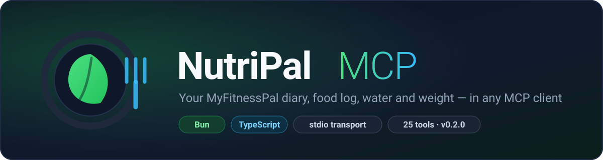
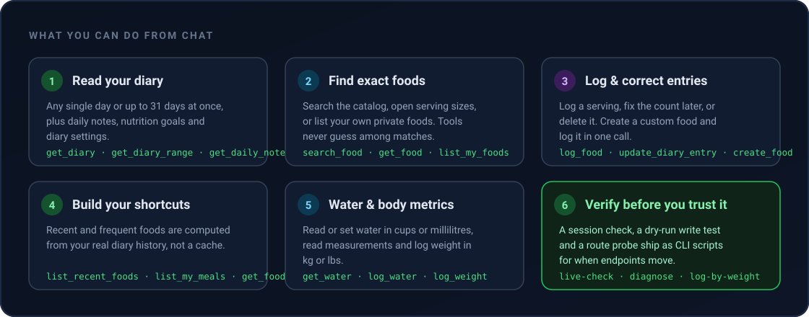
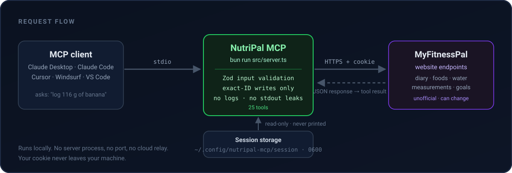

<p align="center">
  
</p>

<p align="center">
  <strong>Your MyFitnessPal diary, food log, water and weight — controllable from any MCP client.</strong>
</p>

<p align="center">
  <a href="https://www.typescriptlang.org/"></a>
  <a href="https://nodejs.org/"></a>
  <a href="https://modelcontextprotocol.io/"></a>
  <a href="https://www.npmjs.com/package/nutripal-mcp"></a>
  <a href="LICENSE"></a>
  <a href="https://github.com/naoufalelbani/nutripal-mcp/releases"></a>
  <a href="https://github.com/naoufalelbani/nutripal-mcp/actions"></a>
</p>

---

NutriPal MCP is a local [Model Context Protocol](https://modelcontextprotocol.io/) server that gives an AI assistant
hands on your MyFitnessPal account. Ask *"what did I eat yesterday"*, *"log 116 g of banana as a snack"* or
*"I've had 500 ml of water today"* — and it happens in your real diary.

It runs as a local Node.js or Bun process over **stdio**. There is no server to host, no port to open, no API key to buy,
and nothing leaves your machine except the requests NutriPal makes to MyFitnessPal on your behalf.

<p align="center">
  
</p>

## Table of contents

- [Why NutriPal](#why-nutripal)
- [How it works](#how-it-works)
- [Quick start](#quick-start)
- [Tools](#tools)
- [CLI scripts](#cli-scripts)
- [Food tab coverage](#food-tab-coverage)
- [Custom foods](#custom-foods)
- [Security](#security)
- [Limits](#limits)
- [Development](#development)
- [License](#license)

## Why NutriPal

| | |
| :--- | :--- |
| **No API key needed** | The [official developer API is private](https://www.myfitnesspal.com/apps/api/documents). NutriPal uses website endpoints with your own session. |
| **Local and private** | stdio transport, no network listener, no telemetry. Your session cookie stays in `~/.config/nutripal-mcp/` with owner-only permissions. |
| **Exact IDs, never guesses** | `log_food` requires a food ID from search or your own list. If two foods look alike, you pick — the tool won't silently log the wrong one. |
| **Honest about failure** | `create_and_log_food` returns the new food ID even when the diary write fails, so you can retry without creating duplicates. |
| **Typed and tested** | Every tool input is Zod-validated, destructive tools are annotated for client-side warnings, and error output is sanitized before it reaches the model. |
| **Debuggable by design** | `live-check`, `live-check --write` and `diagnose` tell you exactly which endpoint broke when MyFitnessPal changes something. |

## How it works

<p align="center">
  
</p>

1. Your MCP client spawns the built Node.js launcher or runs `bun run src/server.ts` and talks to it over stdio.
2. NutriPal validates each tool call with Zod, then issues an HTTPS request to
   `www.myfitnesspal.com` using the `__Secure-next-auth.session-token` cookie.
3. The JSON response is returned to the client as a tool result. Writes require
   exact IDs and destructive tools are flagged with `destructiveHint`.

## Quick start

### 1. Install

The published package runs on Node.js 20 or newer. [Bun](https://bun.sh/) is needed to build or run TypeScript from a checkout.

**One-off, from npm** — no clone needed:

```bash
npx nutripal-mcp
```

**Or clone the repo:**

```bash
git clone https://github.com/naoufalelbani/nutripal-mcp.git
cd nutripal-mcp
bun install
```

From a checkout, `bun run build` creates `dist/*.js` for Node.js. The launcher uses `dist` when present and falls back to Bun source loading during development.

### 2. Save your session

Sign in to [MyFitnessPal](https://www.myfitnesspal.com/) in your browser, open developer tools,
copy the value of the `__Secure-next-auth.session-token` cookie for `www.myfitnesspal.com`, then:

```bash
bun run auth                         # default profile from a clone
npx nutripal-mcp auth                # default profile from npm
npx nutripal-mcp auth --profile work # named profile
```

Paste the token at the hidden prompt. NutriPal verifies it and stores one `0600` file per profile at
`~/.config/nutripal-mcp/sessions/<profile>`. An existing legacy `session` file is read as `default` until a named default session is saved. The value is never echoed back.

> **Prefer not to store it?** Set `MFP_COOKIE` for this invocation. It applies only to the active
> profile (`MFP_PROFILE`, or `default`), accepts a bare token or full `Cookie` header, and is never saved by `auth`.

### 3. Register the server

**Claude Desktop** — `claude_desktop_config.json`:

```json
{
  "mcpServers": {
    "nutripal": {
      "command": "node",
      "args": ["/absolute/path/to/nutripal-mcp/bin/nutripal-mcp.js"]
    }
  }
}
```

**Claude Code:**

```bash
claude mcp add nutripal -- bunx nutripal-mcp
```

**Cursor / Windsurf / VS Code** — same shape, in each editor's MCP settings file:

```json
{
  "mcpServers": {
    "nutripal": {
      "command": "npx",
      "args": ["nutripal-mcp"]
    }
  }
}
```

For a clone, run `bun run build` first, then use `"node"` with
`["/absolute/path/to/nutripal-mcp/bin/nutripal-mcp.js"]`.

### 4. Verify

```bash
bun run live-check          # from a cloned repo
npx nutripal-mcp live-check --profile work   # from npm
```

It checks your session plus every read path and prints a pass/fail list. Keep stdout clear when the
server runs — MCP messages own it, so errors go to stderr.

### 5. Try it in chat

> What did I eat yesterday?
>
> Log 116 grams of banana to today's snacks.
>
> I had a bowl of homemade lentil soup for lunch — save it as a custom food and log it.
>
> Set my water to 1500 ml and log today's weight as 74.2 kg.

## Tools

Every account-scoped tool accepts optional `profile`; it defaults to `MFP_PROFILE` or `default`.
The Access column identifies read-only tools. Reads can run concurrently within and across profiles;
writes are serialized per profile across local server processes sharing `MFP_DATA_DIR`. A write waits
up to one minute for another write to finish, then returns `PROFILE_BUSY`. `list_profiles` returns names, current session validity, and last
verification times, never cookie values.

| Tool | Access | Action |
| --- | :---: | --- |
| `list_profiles` | read | List named profiles and session status |
| `check_session` | read | Check whether the saved MyFitnessPal session works |
| `get_account_settings` | read | Read account, profile, diary, privacy, units, and nutrition goal settings |
| `get_my_profile` | read | Read your profile details and friend count |
| `update_privacy_settings` | write | Change profile, diary, age, and friend visibility preferences |
| `list_my_friends` | read | Read the friends list returned by your profile |
| `get_friends_page` | read | Return the Friends and invite links for browser-based friend management |
| `get_diary` | read | Read food diary entries for a date |
| `get_exercise_diary` | read | Read exercise and step-adjustment entries for a date |
| `get_diary_range` | read | Read diary data across a date range of up to 31 days |
| `get_daily_note` | read | Read the food diary note for a date |
| `get_nutrition_goals` | read | Read current account nutrition goals |
| `get_activity_summary` | read | Read diary, exercise, step, water, and nutrition summaries for up to 31 days |
| `update_nutrition_goals` | write | Update daily calorie, macro, and supported nutrient targets across all weekdays |
| `update_account_profile` | write | Change username, time zone, language, units, and supported diet/fitness profile fields |
| `update_my_profile` | write | Edit location, birth date, sex, height, activity level, headline, About Me, goals, and inspirations |
| `update_diary_settings` | write | Change meal names, tracked nutrients, and diary display/privacy preferences |
| `search_food` | read | Search the food catalog and return exact IDs and serving options |
| `search_exercises` | read | Search the exercise catalog |
| `list_exercises` | read | List the exercise catalog |
| `get_exercise` | read | Read one exercise by ID |
| `list_my_exercises` | read | List private exercises in your account |
| `get_food` | read | Read serving sizes and explicit total/net carbohydrate fields |
| `list_my_foods` | read | Find foods you created, including private foods |
| `list_my_meals` | read | List meals saved in My Meals |
| `list_recent_foods` | read | Recent or frequent foods from up to 31 diary days |
| `get_food_settings` | read | Read food diary settings, including meal labels |
| `get_water` | read | Read water logged on a date |
| `get_measurements` | read | Read body measurements such as weight |
| `get_measurement_types` | read | List available body measurement types |
| `create_food` | write | Save a private custom food with calories, macros and optional nutrients |
| `update_my_food` | write | Edit a private food by exact ID — only supplied fields change |
| `delete_my_food` | write | Delete a private food by exact ID |
| `log_food` | write | Log an exact food ID and serving, then verify the diary row |
| `create_and_log_food` | write | Save a custom food and log it on a day |
| `update_diary_entry` | write | Change servings while preserving the meal, unless `meal` is supplied |
| `delete_diary_entry` | write | Delete an entry and verify its absence from the diary |
| `delete_my_meal` | write | Delete a saved meal by exact ID |
| `log_water` | write | Set water intake for a date, in cups or milliliters |
| `log_weight` | write | Create or update a weight measurement for a date |
| `delete_measurement` | write | Delete a body measurement by exact ID |

Meals are addressed by position: `0` breakfast, `1` lunch, `2` dinner, `3` snacks, and `4`/`5` for extra
meals if you enabled them. Use `get_food_settings` to read your own labels. Dates are always `YYYY-MM-DD`.

## CLI scripts

Installed from npm, the commands are `npx nutripal-mcp <command>`; from a clone, use
`bun run <script>`. `auth` and `live-check` accept `--profile NAME`.

| Command (npm) | Command (clone) | What it does |
| --- | --- | --- |
| `npx nutripal-mcp auth` | `bun run auth` | Verify a session cookie and save it with owner-only permissions |
| `npx nutripal-mcp` | `bun run start` | Launch the stdio server |
| `npx nutripal-mcp live-check` | `bun run live-check` | Read-only sweep of every endpoint the tools depend on |
| `npx nutripal-mcp live-check --write` | `bun run live-check --write` | Create one temporary private food, verify, edit, log, edit the entry, then delete both. Prints the temporary name or ID if cleanup fails so you can remove it manually |
| `npx nutripal-mcp log-by-weight banana 116` | `bun run log-by-weight -- banana 116` | Log a food by gram weight. Shows ranked results, picks an exact match interactively, and defaults to today's Snacks |
| `npx nutripal-mcp log-by-weight banana 116 --date 2026-10-11 --meal lunch` | `bun run log-by-weight -- banana 116 --date 2026-10-11 --meal lunch` | Same, with explicit date and meal |
| `npx nutripal-mcp diagnose` | `bun run diagnose` | Probe read-only food routes and print status codes plus response structure |
| `npx nutripal-mcp --help` | — | Show all commands |
| `npx nutripal-mcp --version` | — | Print the installed version |

From a clone you can also run `bun test` and `bun run typecheck`.

`diagnose` and `live-check` never print the saved session or response bodies — only status codes and
the shape of what came back.

## Food tab coverage

These are implemented tool paths. Live account behavior still needs `bun run live-check`, because
MyFitnessPal's website endpoints can change without notice.

| MyFitnessPal page | Current MCP support |
| --- | --- |
| Food Diary | Read food and exercise entries, log foods, change food servings, delete entries, read notes, read or set water |
| Database | Search foods and view nutrition and serving sizes |
| My Foods | Search/list, view, create, edit, and delete private foods |
| My Meals | List and delete saved meals |
| Exercise | Search and view public and private exercise catalog entries; read and delete exercise diary entries; logging exercise is not yet supported by a verified write endpoint |
| Friends | Read the profile-provided friends list and return the Friends/invite links; friend requests and activity feed are not exposed by the routes checked so far |
| Recipes | No recipe tools yet |
| Settings | Read diary settings and nutrition goals; update nutrition goals, account profile, and diary settings |
| Reports | Read MyFitnessPal activity digest for a date range up to 31 days |
| Data export | Not yet available through the MCP |

My Meals creation and logging, recipe management, exercise diary logging, and other food setting changes still require the
MyFitnessPal website or app.

## Custom foods

For a custom food, nutrient amounts are **per serving**. The default serving is `1 serving`.
For a 100 g nutrition label, set `serving_amount: 100` and `serving_unit: "g"`.

`carbohydrate_basis` is `total` or `net`. When `fiber` is supplied it defaults to `total`;
net input is converted to total for storage. `country_code` selects catalog locale only.
`get_food` reports `carbohydrates` (total), `net_carbs`, `fiber`, and the recorded basis.
For older or external foods without basis metadata, total and net are `null` and the basis is
`unknown`; `raw_carbohydrates` preserves the upstream number without guessing its meaning.
Locally recorded basis metadata is ignored if the upstream carbohydrate or fiber values change.
Use the upstream nutrition label to resolve an `unknown` basis before relying on a carb total.

`log_food` and `create_and_log_food` accept `serving_size_id` (preferred), or
`serving_value` plus `serving_unit`. A legacy `serving_unit` label still works. Labels ignore
case and repeated whitespace. Unknown or ambiguous selections return every valid
`{id, value, unit}` option. An explicit amount never selects a default serving.
Results include the effective serving and a diary read-back status: `persisted`, `entry`,
`diary_entry_id`, and a reason when persistence could not be confirmed.

<details>
<summary><code>create_food</code> example</summary>

```json
{
  "name": "Homemade lentil soup",
  "brand": "Home",
  "serving_amount": 1,
  "serving_unit": "bowl",
  "calories": 220,
  "protein": 14,
  "carbohydrates": 32,
  "fat": 5,
  "fiber": 9
}
```

Optional nutrients: `sugar`, `sodium`, `saturated_fat`, `cholesterol`, `potassium`.

</details>

<details>
<summary><code>create_and_log_food</code> — what happens if logging fails</summary>

The food is created first, and its ID is returned even when the diary write fails:

```json
{
  "created": { "id": "123456789", "...": "..." },
  "persisted": false,
  "diary_entry_id": null,
  "reason": "Diary write failed",
  "diary_error": "Diary write failed",
  "recovery": "The food was created as ID 123456789. Use log_food with that ID; do not create it again."
}
```

Reconcile the diary entry before retrying `log_food`, so a delayed write does not create a duplicate.
If MyFitnessPal returns no ID for a new diary row, the write is unverified even when an identical
row appears in the diary. Creating a food also requires an ID and a matching nutrition read-back;
an unverified result names the submitted food ID when one is available.

</details>

## Security

- The session cookie **grants full access to your MyFitnessPal account**. Treat it like a password.
- Named sessions are stored under `~/.config/nutripal-mcp/sessions/` with `0600` files inside a `0700` directory.
  Override the location with `MFP_DATA_DIR`.
- No command prints the session value, and error output is filtered for tokens, `Bearer` values and
  `__Secure-next-auth` strings before it reaches the client.
- Do not commit the session file or paste its contents in an issue.
- NutriPal performs no analytics, makes no requests other than to MyFitnessPal, and opens no ports.

## Limits

Tool errors are returned as structured results with `code`, `message`, and optional `hint` and
`status`. Redirects and authentication failures use `MFP_SESSION_STALE` with a profile-specific
reauthentication hint; 404 uses `NOT_FOUND`, 429 uses `RATE_LIMITED`, and other upstream failures
use `UPSTREAM_ERROR`. A tool error does not mean the MCP stdio transport is unreachable.

Before using a new release with real accounts, run `live-check --profile NAME` for each profile.
With a disposable food and diary date available, run `live-check --profile NAME --write` and review
its cleanup report. This write check changes account data. Do not publish or rely on a new version
until these live checks pass against the current MyFitnessPal website. The website endpoints are
outside this project's control, and mocked tests cannot establish their live behavior.

- MyFitnessPal's website API is **undocumented and can change** at any time. When it does, run
  `bun run diagnose` to see which route moved.
- MyFitnessPal's [developer portal](https://www.myfitnesspal.com/apps/api/documents) says its official API
  is available to approved developers only. An external approval or supported API agreement may be
  needed before operating a public integration.
- This project is **unaffiliated with MyFitnessPal**. It is not endorsed by or connected to
  MyFitnessPal, Inc.
- Some accounts receive Cloudflare challenges from non-browser clients. If that happens, refresh the
  browser session or use a network where MyFitnessPal allows the request.
- There is no password login and no automatic session renewal — when the session expires, save a new one.
- No local diary cache: reads reflect MyFitnessPal's current response.
- Recipe tools and My Meals creation are not implemented.

## Development

```bash
bun install        # install dependencies
bun test           # unit tests
bun run typecheck  # tsc --noEmit
bun run build      # compile Node.js bundles in dist/
bun run start      # run the stdio server
```

Project layout:

```
src/
  server.ts        # MCP tool registration and stdio transport
  mfp.ts           # MyFitnessPal HTTP client, session storage, error sanitizing
  auth.ts          # interactive session saver
  live-check.ts    # read-only and --write endpoint verification
  log-by-weight.ts # weight-based logging CLI
  diagnose.ts      # read-only route probe
dist/              # generated Node.js output (built before publishing)
test/
  mfp.test.ts
assets/            # banner and diagrams
```

Contributions are welcome. Please run `bun test` and `bun run typecheck` before opening a PR, and
include a `live-check` result if your change touches an endpoint.

## Releasing

CI runs the tests, typecheck and a package dry-run on every push and pull request.

Publishing to npm is automated. **Create a GitHub Release** and the
[`Publish to npm`](.github/workflows/publish.yml) workflow publishes the version in `package.json`:

```bash
# 1. bump "version" in package.json, update CHANGELOG.md, commit
VERSION=$(node -p "require('./package.json').version")
git commit -am "Release v${VERSION}"
git push

# 2. write version-specific release notes, then tag and publish
gh release create "v${VERSION}" --title "NutriPal MCP v${VERSION}" --notes-file release-notes.md
```

The workflow runs `bun test`, `bun run typecheck`, and `bun run build` before publishing, skips versions already on
npm so a re-run is safe, and attaches a [provenance attestation](https://docs.npmjs.com/generating-provenance-statements)
linking the package back to this commit.

**One-time setup:** configure npm trusted publishing for the `Publish to npm` workflow in
the npm package settings. The workflow uses GitHub's OIDC identity and does not need an npm token.

## License

[MIT](LICENSE) © Naoufal Elbani
